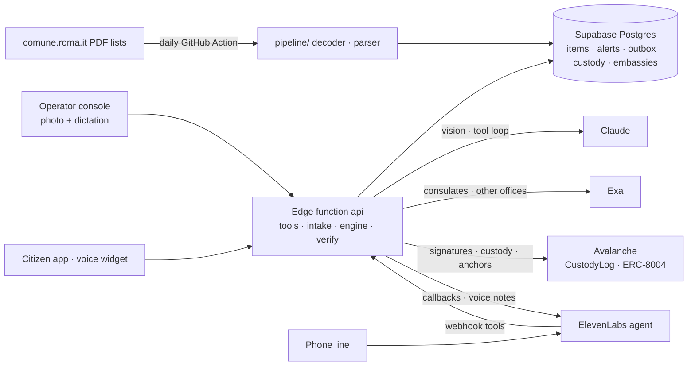

# Ritrovo: Rome's lost-and-found, returned

**Agentic Hack Rome 2026 · Challenge 03 "Oggetti smarriti"**

Rome's lost-and-found office (Reparto Oggetti Rinvenuti, Polizia Locale di Roma Capitale) logs about
**600 found objects a month** and publishes them as yearly PDF lists of **500–700 pages**. The PDFs use fonts with
no text map: search, copy-paste and screen readers return gibberish. To know whether your passport was handed in,
you scroll the PDF or phone the office, which answers on weekday mornings.

Ritrovo decodes those lists and then does something the office can't do today: **it returns items instead of
waiting for people to search.**

| | |
|---|---|
| Records decoded from the official PDFs (2025 + 2026) | **15,843** records, 48,797 objects, 0 gaps |
| Records containing an identity document | **7,649 (48%)**: the owner is identifiable |
| Records with a foreign document | **4,470**: a consulate can be told |
| Records with a published ownership prefix (document/IMEI) | **9,109** |

## What it does

1. **Decodes the city's lists.** Every glyph in the PDFs is a Type 3 drawing with no Unicode mapping. Ritrovo
   fingerprints the 102 distinct glyph shapes, maps them once, and rebuilds every record exactly. No OCR, no
   guessing (`pipeline/`). A daily GitHub Action imports each new list.
2. **Smart intake for the office.** The operator photographs a handed-in object and dictates a note. Claude
   (vision + structured output) turns it into a register entry in the office's own style. Document numbers are
   masked before anything is stored, logged or sent to a model.
3. **Return engine (agent + policy guard).** A Claude tool-use agent routes each item: Italian identity
   documents → a notice to the holder (App IO style), foreign documents → that country's consulate in Rome
   (contacts found and kept fresh with **Exa**), anything else → matched against citizens' alerts. A deterministic
   policy guard makes sure every legally required notification exists, whatever the model did.
4. **A 24/7 multilingual voice line (ElevenLabs).** Callers describe what they lost in their own language; the
   agent finds the item from the first characters of the document number or IMEI (public in the official list),
   then proves ownership with a detail that is never published: the last four characters, or exactly how much
   cash was inside (Ritrovo keeps only salted hashes from intake). It states the fees and sends a pickup pack with
   a pre-filled delega.
5. **Sentinel alerts.** No match yet? Leave an alert. When a new intake or a new official list contains the item,
   Ritrovo notifies the owner: an outbound call if a phone line is connected, otherwise a voice note in their
   language.
6. **Trust layer on Avalanche.** Every outgoing message is signed by the agent's key and verifiable at
   `/verify/{id}` (tampering is detected). Custody events (intake → routed → returned) and the fingerprints of
   each official list (PDF sha256 + Merkle root of decoded records) are logged in `CustodyLog` on Avalanche. The
   agent has an **ERC-8004** identity. Only hashes go onchain.

## Live on Avalanche Fuji

| | |
|---|---|
| `CustodyLog` contract | [`0xa5aAb3b1743922ED1eabaB6C2647787B92807B48`](https://testnet.snowtrace.io/address/0xa5aAb3b1743922ED1eabaB6C2647787B92807B48) |
| Ritrovo agent (ERC-8004) | agentId **302** in the Identity Registry [`0x8004A818…94BD9e`](https://testnet.snowtrace.io/address/0x8004A818BFB912233c491871b3d84c89A494BD9e) ([registration tx](https://testnet.snowtrace.io/tx/0x149f16d2508fafcb679650520dd0a8ba3ac6d951260ccdde2891716bd4c97ce0)) |
| Agent wallet (signs messages, writes custody) | [`0xD81fF9E6685A80C9cA31EE10c9311ebb66A70Fd1`](https://testnet.snowtrace.io/address/0xD81fF9E6685A80C9cA31EE10c9311ebb66A70Fd1) |
| Official list 2025 anchored | [tx](https://testnet.snowtrace.io/tx/0x3c4b5212397fae6b528083ffaca4fb522542b2843520f52f441d4bf8425cb4fc) (8,903 records, Merkle root `0xbd9a1b35…`) |
| Official list 2026 anchored | [tx](https://testnet.snowtrace.io/tx/0x168a4a1b2055247d9adffaaca8d219a3aff104c26459bd19327f4c8c4d5a21f2) (6,940 records, Merkle root `0xed0a52e4…`) |
| Office wallet (Reparto Oggetti Rinvenuti) | [`0xA5cdA457e2053320FDF10099d14049C263612890`](https://testnet.snowtrace.io/address/0xA5cdA457e2053320FDF10099d14049C263612890): rates and validates the agent; ERC-8004 forbids an agent rating itself |
| ERC-8004 Reputation | after every return the office records feedback on agent 302 (tag `returned`) in [`0x8004B663…388713`](https://testnet.snowtrace.io/address/0x8004B663056A597Dffe9eCcC1965A193B7388713) |
| ERC-8004 Validation | every AI routing decision is submitted by the agent and scored 0–100 by the office against the policy (tag `policy`) in [`0x8004Cb1B…EB4272`](https://testnet.snowtrace.io/address/0x8004Cb1BF31DAf7788923b405b754f57acEB4272) |
| Track record (live, read from the registries) | `GET /agent/track-record` |
| Proof of publication | `GET /items/{id}/proof`: Merkle proof of any official record against the list root anchored above, checked against the onchain event |

The contract source is verified on the explorer. Only hashes and scores go onchain, never personal data.

## Architecture



Details: [`docs/ARCHITECTURE.md`](docs/ARCHITECTURE.md). Build plan and decisions log: [`docs/PLAN.md`](docs/PLAN.md).

## Sponsor technologies

| Sponsor | Where it does real work |
|---|---|
| **ElevenLabs** | The office's voice line: agent with 6 webhook tools into the API, 8 languages (EN + 7 presets), data collection for call analytics; outbound callbacks and voice notes for alerts (`supabase/functions/api/lib/voice.ts`) |
| **Exa** | Consulate directory (structured contacts per country with source URL, `deep-lite` + `outputSchema`); other lost-and-found offices for the place of loss (`lib/exa.ts`) |
| **Avalanche** | `CustodyLog` contract (intake/routed/returned events, dataset anchors), ERC-8004 agent identity, EIP-191 signed messages (`contracts/`, `lib/chain.ts`) |
| **Lovable** | Citizen app and operator console (`lovable/PROMPTS.md`) |
| **Claude** | Intake understanding (vision, structured output) and the routing agent (strict tool use, server-side refusal fallback) (`lib/llm.ts`, `lib/engine.ts`) |

## Run it

```bash
# 1. Decode the official PDFs (data/raw) into records and the catalogue
pip install -r requirements-dev.txt
python3 -I pipeline/decode_pdf.py data/raw/Rinvenimenti_01012026_11112026.pdf pipeline/glyph_table.json data/processed/lines_2026.jsonl
python3 -I pipeline/parse_records.py data/processed/lines_2026.jsonl 2026 data/processed/items_2026.jsonl
python3 -I pipeline/build_dataset.py
python3 -m pytest -q tests

# 2. Database + API (Supabase project ref in supabase/config.toml)
python3 -I pipeline/load_supabase.py <project_ref> --migrate
npx supabase functions deploy api --use-api --no-verify-jwt

# 3. Contracts
cd contracts && npm install && npx hardhat test && npm run deploy:fuji && npm run register:fuji

# 4. Checks
scripts/smoke.sh                                  # 22 API checks
(cd supabase/functions/api && deno test lib/)     # rule-layer unit tests
```

Edge function secrets: `OPERATOR_TOKEN`, `ANTHROPIC_API_KEY`, `EXA_API_KEY`, `ELEVENLABS_API_KEY`,
`ELEVENLABS_AGENT_ID`, `AGENT_PRIVATE_KEY` (testnet key), `ITEM_SALT`, `CHAIN_ID`, `CUSTODY_CONTRACT`,
`ERC8004_AGENT_ID`, `APP_URL`. Without the sponsor keys every flow still runs on the deterministic rule layer;
`GET /admin/status` shows what is live.

## Privacy and safety

- No personal data is published. Document numbers stay masked exactly as in the official list. Full numbers
  typed by an operator are masked before storage, logging or any model call.
- Alerts' contact details are never returned by public endpoints (Postgres RLS; masked in the console).
- Onchain: only hashes (item ids are salted). Nothing identifies a person.
- **Demo mode:** nothing is sent to real embassies, citizens or the city. Messages land in an outbox.
- Every message tells citizens that Ritrovo never asks for online payments, and can be verified at `/verify/{id}`.

## Status

Prototype built in ~20 hours. **Not an official Roma Capitale service.** Data: public lists of the Reparto
Oggetti Rinvenuti (comune.roma.it, service "Ritirare un oggetto smarrito"). Fees: Deliberazione G.C. n. 421/2023.
